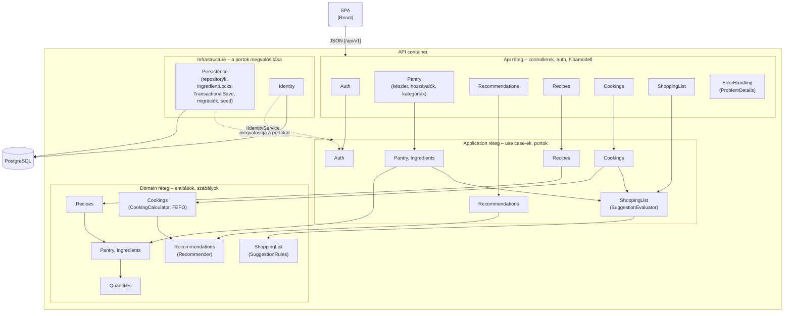

# C4 – Component view (az API belseje)

Az API container ([c4_context_container.md](c4_context_container.md)) moduljai, a Clean Architecture rétegeivel ([ADR-0004](adr/0004-clean-architecture-retegek.md)). Egy modul = egy mappa minden rétegben (`Api/<Modul>`, `Application/<Modul>`, `Domain/<Modul>`), az adatelérés az Infrastructure `Persistence` mappájában.

| Modul | Felelősség | Api | Application | Domain |
|---|---|---|---|---|
| Auth | Regisztráció, bejelentkezés, háztartás létrehozása | `Api/Auth` | `Application/Auth` | `Domain/Households` |
| Pantry | Készlettételek, mozgásnapló, becsült lejárat; hozzávalók és minimumszint | `Api/Pantry` | `Application/Pantry`, `Application/Ingredients` | `Domain/Pantry`, `Domain/Ingredients`, `Domain/Quantities` |
| Recommendations | „Mit főzzek?” | `Api/Recommendations` | `Application/Recommendations` | `Domain/Recommendations` |
| Recipes | Saját recept, archiválás | `Api/Recipes` | `Application/Recipes` | `Domain/Recipes` |
| Cookings | Előnézet, megerősítés, levonás | `Api/Cookings` | `Application/Cookings` | `Domain/Cookings` |
| ShoppingList | Lista, javaslatok, a javaslatok kiváltása | `Api/ShoppingList` | `Application/ShoppingList` | `Domain/ShoppingList` |

**Függőségi szabályok:**
- Befelé mutatnak: Api → Application → Domain; az Infrastructure az Application portjait valósítja meg. A Domain nem hivatkozik más rétegre, az Application nem hivatkozik az Infrastructure-re és az ASP.NET Core-ra; ezt a [LayerRulesTests.cs](../../tests/KamraApp.Unit.Tests/LayerRulesTests.cs) ellenőrzi.
- A modulok közti hívás az Application rétegben történik, és egy irányba: a készlet és a főzés változásai a ShoppingList `SuggestionEvaluator`-át hívják (egy tranzakcióban, ADR-0008), fordítva nem.
- Minden repository-port háztartáshoz kötött metódusa megkapja a háztartás azonosítóját (QA-1).
